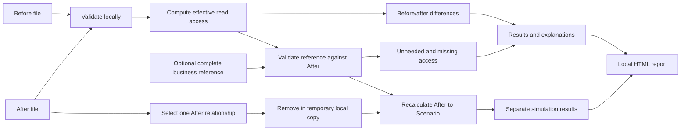

# AccessDiff — Technical Specification

## How This Works, In Plain Language
AccessDiff opens on the computer in a browser. The reviewer supplies files describing access before and after a change. The browser checks those files, follows every supported route through the groups, and compares the access that each person actually obtains under this model. Selecting a result shows one valid route and the relationships that changed.

For the requested least-privilege review, an optional third file declares all read access required for the people and resources in the after snapshot. AccessDiff compares actual access afterward with those declared needs. It can show an unneeded access that remains, or a needed access that has been removed. The author of the reference must establish the business needs; the application cannot infer them or certify their correctness.

The approved extension tests one removal from the existing After relationships in a temporary local scenario. It recalculates access, identifies affected rights that survive through another path, and separates newly missing requirements from requirements already missing in After. This does not modify either imported snapshot, the reference or a real system.

Imported files and results remain in the open page's memory. A downloaded HTML report is a separate local file. Node.js only serves the application files locally and runs development tests; imported data is not uploaded to it. There is no account, cloud runtime, paid API, billing setup, or required hosting.

Hugo approved this plan with "je valide" after review of its least-privilege reference and the explicit request to proceed to code. It implements the approved product definition and his subsequent request for precise least-privilege refinement.

Hugo then approved the focused removal simulation with “ok lets go” after the contest-readiness discussion. It extends the same local modules and input contracts without adding a service, dependency or billing setup.

## The Core Journey Through the System
Implements `prd.md > The Core Journey`.

1. The reviewer opens the local URL and chooses the bundled example or local files.
2. The import/session module reads file text and passes it to the validators. Before and After remain distinct. An optional business reference is checked against After.
3. The access engine follows memberships and grants, computing all effective read access for both snapshots. It compares the results and reconstructs representative explanations.
4. If a complete valid business reference is present, the policy evaluator separately computes unneeded and missing access in After. Otherwise this assessment is explicitly not performed.
5. The interface shows the original results and explanation. A separate panel offers an optional single After membership/grant removal. The simulation engine recalculates current After → Scenario without changing the original analysis.
6. A local report generator exports the original findings and, when current, a separately labelled simulation with its selected relationship and consequences.



## Stack
- **HTML, CSS, JavaScript ES modules:** one small screen does not need a framework or bundler. Use native modules and relative imports, with `type: "module"` in `package.json`. [MDN module guide](https://developer.mozilla.org/en-US/docs/Web/JavaScript/Guide/Modules).
- **Browser-native file handling:** `File.text()` through the Blob interface for imports; Blob and object URLs for the local report download. [Blob.text](https://developer.mozilla.org/en-US/docs/Web/API/Blob/text), [URL.createObjectURL](https://developer.mozilla.org/en-US/docs/Web/API/URL/createObjectURL_static).
- **Node.js 24:** the installed runtime was verified as v24.19.0. Use built-in HTTP, filesystem and test modules only, compatible with this installed version. No runtime upgrade is required by the plan. [Node 24 HTTP](https://nodejs.org/docs/latest-v24.x/api/http.html), [Node 24 test runner](https://nodejs.org/docs/latest-v24.x/api/test.html).
- **No external npm dependencies:** no package installation or network call is needed to launch the finished source. Node's applicable license and bundled third-party notices are available in its [v24.19.0 license](https://raw.githubusercontent.com/nodejs/node/v24.19.0/LICENSE); using the installed runtime requires no billing account.

Accepted tradeoff: UI rendering and file validation are implemented directly, while dependencies, build tooling, and service setup remain small. This was accepted through the technical-plan review rather than inferred as a pre-existing framework preference.

## Where It Runs and How Someone Tries It
From the AccessDiff folder, with Node.js 24 installed:

```text
npm start
```

This runs `node scripts/serve.mjs`. Open **http://127.0.0.1:5174/**. The distinct port avoids confusing this project with the previous prototype. No `npm install`, API key, internet access, or hosted deployment is required to run the application after obtaining its source.

Tests: `npm test`, which runs `node --test`. Optional alternate port: `node scripts/serve.mjs --port 5175` if 5174 is occupied. Do not stop unrelated processes.

Use local HTTP rather than double-clicking `index.html`, because the application uses modules and local example fetches. The server only serves explicitly allowed public files on the loopback address.

For the submission, record the bundled example, its before/after explanation, business-reference findings and the N1 → N2 removal scenario's two different consequences. Keep instructions for a short demo video and a public source repository in the README. Publishing a repository and video is a separate ship step; deployment is optional and not proposed here. Node is not bundled or redistributed with the project.

## Look and Feel
Implements `prd.md > Screens and Layout` and `prd.md > Look and Feel`.

- CSS custom properties: background `#f4f7f8`, surface `#ffffff`, main text `#172d3b`, secondary text `#52646f`, primary blue `#24485b`, sea-green accent `#277e78`, dividers `#d8e2e7`.
- Native system font stack; no downloaded fonts, remote imagery, icon service, or CDN.
- One desktop workspace: Before/After inputs at the top, compact optional reference input, results on the left and selected explanation on the right. Use CSS Grid; at narrower browser widths stack these areas without clipping controls or paths.
- Distinguish the before/after view from the business-reference view using two clearly named controls within the results area. The latter shows its not-assessed state when no reference is present.
- Place removal simulation in a separate section below the original review, with an entry action from that review. Use an existing-After-relationship selector, an explicit test action and an action to cancel the simulation. Label its timeline current After → Scenario, never Before → After.
- Use explicit labels and symbols with the accents. Gains/losses and reference deviations have distinct meanings; do not use a green score or general compliance badge.
- Paths are vertical sequences of named steps so their direction remains clear at every width. Highlight changed relationships with readable text annotations. Increase useful detail text to at least 12px where practical. No interactive graph library is needed.
- French interface wording, semantic controls, keyboard-visible focus and a polite status region for input validation and analysis outcomes.

## Components

### Strict JSON Reader
Implements the file-reading boundaries in `prd.md > Load and Validate Snapshots` and `prd.md > Assess Declared Minimum Access`.

`src/json.js` supplies a shared strict JSON reader for snapshots and references, including file/text size and nesting limits. Reject duplicate object keys by comparing their decoded names (`"id"` and `"\u0069d"` are the same key), using a structural token walk rather than a regular expression. Use the built-in JSON parser for syntax and values, with the additional key/depth check before accepting data.

### Snapshot Validation
Implements `prd.md > Load and Validate Snapshots`.

`src/snapshot.js` parses and validates snapshots with no DOM or Node dependency. Return normalized data and indexes, or an error with the input role, field path, and readable reason. Reject the entire invalid input; never silently drop unsupported entries.

Validate version, exact properties, types, identifiers, reference types, duplicate entities and relations, and group cycles. Use Maps/Sets rather than imported IDs as object property names. Use the shared strict JSON reader so duplicate JSON keys cannot silently overwrite data accepted as evidence.

Group-cycle detection covers all groups, including unused groups, and rejects self-membership. Across snapshots, a stable ID cannot change entity type. A display-name change alone is not a permission change. Document that ID reuse for a different real identity cannot be detected from these files and violates the input contract.

### Effective Access and Difference Engine
Implements `prd.md > Compare Effective Read Access` and `prd.md > Explain an Access Change`.

`src/access.js` contains pure functions:

1. Build a directed graph of member → group and grant subject → resource. Resources are terminal nodes; membership targets are groups only.
2. For each person, traverse the complete reachable graph in breadth-first order. Sort outgoing edges by destination ID with an explicit code-unit string comparison, independent of locale and input array order.
3. The reached resource IDs form that person's effective access set. Record predecessors to reconstruct one shortest representative path; do not enumerate every possible path. All supported paths still contribute to deciding whether access exists.
4. Compare access sets on the union of person IDs: After minus Before yields gains; Before minus After yields losses. An absent person has an empty set in that snapshot. Resource IDs are identities, not names.
5. For gains, reconstruct the path and labels from After. For losses, reconstruct them from Before, after confirming that no route remains in After.
6. Compare semantic edge identities against the other snapshot. Annotate every added/removed relationship on the displayed path, and identify removed path entities where relevant. Every gain/loss must have a changed relationship; absence of one is an internal error, not a fabricated explanation.

Semantic edge keys are encoded tuples of edge kind, source ID, destination ID, and permission where applicable, rather than delimiter-concatenated user IDs. Sort findings by stable person/resource IDs for reproducible results. Labels always come from the snapshot used as evidence.

### Business Reference Validation and Evaluation
Implements `prd.md > Assess Declared Minimum Access`.

`src/policy.js` uses the shared strict JSON reader, validates the optional reference and evaluates After:

- Its declared people/resource ID sets must exactly match After, without duplicates. This makes the assessment's complete scope explicit and detects a reference intended for a different population.
- Every requirement refers to one of those people/resources. Unknown IDs are validation errors, not missing rights. A reference to an entity deleted before After is invalid.
- Each omitted person/resource pair is declared not required, because coverage is explicitly exhaustive. An empty requirement list with complete population coverage is valid.
- Let A be effective read access in After and R the declared required pairs. A minus R is unneeded access according to the reference; R minus A is required access missing. A intersect R needs no finding row.
- Explain an unneeded access with a valid After path. Explain missing required access with the reference entry and the absence of any After path; do not fabricate a granting route.
- No reference means not assessed. Zero deviations means only no deviations from this supplied reference. Structural validation cannot validate the business author's declaration.

The combined `analyzeAccess` result enriches every change and reference finding with `context: { before: boolean, after: boolean, requirement: 'required' | 'not-required' | 'not-assessed' | 'out-of-scope' }`. Read both booleans from the actual computed access maps, including unchanged excess access and a missing requirement that was already missing Before. With no reference, requirement is not-assessed. With a valid reference, a pair whose person or resource is absent from After is out-of-scope. Otherwise use membership in `requiredRead`; never infer a need from an observed grant. This context adds explanation data without changing findings or counts.

This follows the least-privilege direction of limiting privileges to those necessary for assigned tasks; see the [NIST definition](https://csrc.nist.gov/glossary/term/least_privilege). It is not an implementation of a compliance framework or an audit of actual Windows ACLs.

### Single-Relationship Removal Simulation
Implements `prd.md > Test One Relationship Removal`.

`src/simulation.js` supplies pure functions using the existing normalized snapshots, semantic edge identities and access/reference engines:

- `listRemovableRelations(after)` returns a deterministically ordered list of existing After memberships and read grants, with stable semantic IDs and display labels. There are no additions, entity deletions or imported scenario files.
- `simulateRemoval(after, reference, relationId)` resolves one existing relationship, constructs a temporary snapshot without that relationship, and returns `{ relation, changes, counts, reference, impact: { status, removedUnneeded, newlyMissing, alreadyMissing, remainingUnneeded }, retained }`. Reject an unknown or stale relation ID. Never mutate the normalized After snapshot or supplied reference.
- `changes` and `counts` compare current After against the scenario using complete effective-access computation. Under the positive-read model, removing one edge cannot create access. Former-path evidence for losses comes from After; scenario paths show only remaining relationships.
- Let A be effective After pairs, S scenario pairs and R declared requirements. With a valid reference, `removedUnneeded` is `(A minus S) minus R`, `newlyMissing` is `(A minus S) intersect R`, `alreadyMissing` is `R minus A`, and `remainingUnneeded` is `S minus R`. Keep these categories separate; the scenario's reference result also records its complete excess/missing findings. Without a reference, impact status is not assessed and no business conclusion is derived from empty assessed lists.
- `retained` contains only person/resource pairs with a supported After route through the selected relationship that still have a granting route in the scenario. Determine participation using all supported reachability, not merely the representative shortest path. Include one valid surviving scenario path and actual current After/scenario context. A wholly unrelated unchanged access is excluded.
- A scenario is atomic and subject to the existing input bounds. Reject it if `changes + scenario reference findings + retained` exceeds 1,000 rows; show no partial scenario. The original comparison and scenario are each bounded separately in the combined report.

The example N1 → N2 removal yields Clara's two losses, one removed non-required access (Contracts), one newly missing requirement (Plan), and one already missing requirement (Julien/Contracts). Nadia/Plan is unrelated to the removed membership and does not belong in `retained`. These are observed consequences under the supplied model, not a safe-removal or compliance verdict.

### Import Session and Freshness
Implements `prd.md > Load and Validate Snapshots` and `prd.md > States and Boundaries`.

`src/session.js` owns in-memory input statuses, validated values, errors, selected original result/view, the original analysis revision, the current simulation/error, available relations and a stable current export object. `src/app.js` connects these states to the page and maintains only the chosen relation control and selected simulation finding. Each recalculation starts from the stored After input; the interface never mutates imported snapshots.

- On starting any file replacement or removing the reference, invalidate the comparison, assessment, explanation and export immediately.
- Each input has a monotonically increasing load token. Ignore a completed read whose token no longer matches, so an earlier slow file cannot replace a newer selection.
- Before/After reads may complete independently. Revalidate reference coverage when After changes.
- The example action loads all three local example files through the same validators. Commit that example only if its captured input tokens are still current; a later manual selection wins.
- Enable analysis only when Before/After are valid and a supplied reference, if any, is valid against After. Invalid optional reference data must be fixed or explicitly removed; do not silently ignore it.
- Results and reports carry the revision they were calculated from. Export only that revision while inputs remain current.
- Clear the selected scenario and its findings immediately on any new input/reference read, reference removal, example load or analysis run. Changing the relationship selection clears its former result until the selected removal is tested. Cancel removes the scenario only; the current original analysis remains available.
- Every test starts from the unchanged validated After snapshot. Never use a previous scenario as the next scenario's input. An invalid relation, limit failure or stale analysis cannot preserve a misleading old simulation.
- No localStorage, IndexedDB, service worker, telemetry, imported-data server writes, or saved project feature. Reload starts empty.

### Desktop Interface
Implements `prd.md > Screens and Layout`, `prd.md > Look and Feel` and `prd.md > States and Boundaries`.

`index.html`, `styles.css`, and `src/app.js` render the single approved workspace. Use text nodes/`textContent` for imported labels and file names. Do not inject imported HTML or URLs.

Results offer a before/after view and a separate business-reference view. Selecting a row updates the shared explanation. A missing required access has no path to draw; show its declared requirement and absent After access. Changing inputs or views clears an incompatible selection.

Each selected finding shows Before access, After access and declared need together, then a plain-language explanation grounded in the evidence. For gains/losses, name all changed relationships on the representative path without claiming a unique cause or proposing a safe removal. At reference import, explicitly explain omitted pairs and distinguish valid format/scope from human approval of business needs.

Show real access-pair counts with explicit wording. Cover initial, reading, invalid, ready, no-change, not-assessed, no-deviation and internal-failure states without success claims in place of missing evidence. The current analysis can be exported even when it has no differences/findings.

After a successful analysis, a separate simulation section offers all existing After relationships; explain when none are available. Show the selected relationship, observed losses, affected access retained through an alternative path, and reference impact categories with named people/resources and evidence. Do not conflate the original Before/After context with current After/scenario context. The controls are labelled in French, keyboard accessible, and the cancellation action clearly removes the scenario without altering inputs or original findings.

### Local Report
Implements `prd.md > Export a Readable Report`.

`src/report.js` produces a self-contained UTF-8 HTML document with inline print-friendly CSS, no scripts and no external assets. Download through a Blob/object URL with a fixed file name such as `accessdiff-rapport.html`, then release the URL after the download has been triggered.

Include input file names, counts, every before/after finding and its explanation, and every reference finding if assessed. Include the reference's population coverage and explicit not-assessed status when absent. Escape all imported strings, including names, file names and reference evidence. Apply an appropriate restrictive report meta CSP. No imported string becomes an HTML attribute or link target.

Include the supported positive-read model, supplied-data assumption, representative-path meaning, and limits of the business reference. A report with no deviations must not assert that a real system is secure or compliant.

Export each finding's same Before/After/declared-need context and plain-language evidence. Do not export an incomplete context by guessing it from the finding kind.

When a current simulation is provided, append a distinctly titled section that identifies its baseline as the loaded After snapshot, names the single removed relationship and states that no input or external system was modified. Include all scenario changes, affected retained-access paths, reference consequences and explicit not-assessed status when no reference exists. Distinguish newly missing from already missing requirements. Preserve the entire original analysis and its original counts; do not replace them with scenario values. Apply the same escaping and self-contained report constraints to every simulation label and evidence string. A reset/invalidated scenario must not be exported.

### Local Static Server
Implements the local run workflow, not a business-data API.

`scripts/serve.mjs` uses Node built-ins and listens on `127.0.0.1` only. Serve an explicit route-to-file allowlist for the HTML, CSS, eight JavaScript modules (including `/src/simulation.js`), three example JSON files and the single public `/docs/input-format.md` document linked from the interface. Do not serve the project directory generically, planning documents, private profile, dotfiles, environment files, tests or arbitrary paths.

Support GET/HEAD with correct HTML, CSS, JavaScript and JSON MIME types; reject other methods and unknown routes. Use no-store and nosniff headers and a self-only application CSP suitable for local modules and example fetches. Local file imports are never request payloads. No snapshot/request-body logging or filesystem write endpoint. Report an occupied port with the alternate-port command rather than stopping another process.

## Data Model

### Snapshot JSON v1
All listed root fields and record properties are required; unknown properties are rejected.

```json
{
  "schemaVersion": 1,
  "people": [
    { "id": "p:clara", "name": "Clara" },
    { "id": "p:julien", "name": "Julien" },
    { "id": "p:nadia", "name": "Nadia" }
  ],
  "groups": [
    { "id": "g:support-n1", "name": "Support N1" },
    { "id": "g:support-n2", "name": "Support N2" },
    { "id": "g:pilotage-it", "name": "Pilotage IT" }
  ],
  "resources": [
    { "id": "r:plan-it", "name": "Plan de renouvellement IT" },
    { "id": "r:contrats", "name": "Contrats fournisseurs" }
  ],
  "memberships": [
    { "memberId": "p:nadia", "groupId": "g:pilotage-it" },
    { "memberId": "p:clara", "groupId": "g:support-n1" },
    { "memberId": "g:support-n1", "groupId": "g:support-n2" },
    { "memberId": "g:support-n2", "groupId": "g:pilotage-it" }
  ],
  "grants": [
    { "subjectId": "g:pilotage-it", "resourceId": "r:plan-it", "permission": "read" },
    { "subjectId": "g:support-n2", "resourceId": "r:contrats", "permission": "read" }
  ]
}
```

This illustrates the complete After snapshot from the bundled demonstration. Membership members and grant subjects are people or groups. Membership targets must be groups; grant targets must be resources. Entity IDs are globally unique within a snapshot and stable across snapshots. Relation identity is its semantic tuple; duplicates are invalid.

IDs use `[A-Za-z0-9][A-Za-z0-9._:-]{0,63}` and are case-sensitive. Names are nonblank strings of at most 160 UTF-16 code units. Resources have no hierarchy. There are no denies, implicit grants, write rights, conditional permissions, or platform-specific inheritance.

### Business Reference JSON v1
All fields and record properties are required; unknown properties and duplicates are rejected.

```json
{
  "schemaVersion": 1,
  "coverage": "all-after-pairs",
  "peopleIds": ["p:clara", "p:julien", "p:nadia"],
  "resourceIds": ["r:plan-it", "r:contrats"],
  "requiredRead": [
    { "personId": "p:nadia", "resourceId": "r:plan-it" },
    { "personId": "p:clara", "resourceId": "r:plan-it" },
    { "personId": "p:julien", "resourceId": "r:contrats" }
  ]
}
```

The ID sets must exactly match the loaded After snapshot, whether bundled or imported. The two format examples above are a matched After/reference pair. Input documentation must also provide the complete Before snapshot for the approved two-gain/two-loss demonstration.

No implied wildcard, default grant, group-based requirement, or partially covered population. Requirement entries state necessary read access directly; any omitted pair in the complete scope is declared unnecessary. The reference author makes that declaration outside the application.

### Limits and Lifetime
For this bounded proof of concept, reject inputs/results exceeding these documented limits rather than truncate them:

- 256 KiB per UTF-8 file, checked against `File.size` before reading and against encoded text size for non-file input.
- 100 total people/groups/resources per snapshot; 500 memberships plus grants per snapshot.
- Maximum raw-JSON nesting depth 16; fixed record structure is much shallower.
- At most 2,500 requirement entries, further constrained by valid After pairs and file size.
- At most 1,000 reported rows across access differences and reference deviations combined. If analysis exceeds the limit, report a size limitation and produce no partial result/report.
- A removal scenario separately permits at most 1,000 combined changes, scenario reference findings and affected retained pairs. Exceeding this rejects the whole scenario; it does not invalidate or replace the separately bounded original analysis. The combined report clearly separates those two results.

Read file text once, validate, and retain only the normalized in-memory inputs and findings needed by the page. Neither imported data nor results survive reloading. Downloaded reports remain where the browser saves them.

## File Structure
Implemented application files and planning records:

```text
accessdiff/
├── index.html                  # One semantic desktop workspace
├── styles.css                  # Calm visual direction, layout, focus states
├── package.json                # type: module; start/test scripts; no dependencies
├── src/
│   ├── app.js                  # DOM events, rendering, example loading, download
│   ├── session.js              # In-memory inputs, read tokens, result freshness
│   ├── json.js                 # Shared strict JSON size/depth/decoded-key checks
│   ├── snapshot.js             # Strict JSON and snapshot validation/indexes
│   ├── access.js               # Effective access, differences, path evidence
│   ├── policy.js               # Complete business reference and deviation sets
│   ├── simulation.js           # One After relationship removal and its consequences
│   └── report.js               # Escaped standalone report HTML
├── examples/
│   ├── before.json             # Approved fictional IT-team starting snapshot
│   ├── after.json              # Two relationship edits, no other changes
│   └── required-read.json      # Three required accesses, complete After coverage
├── scripts/
│   └── serve.mjs               # Loopback-only static allowlist server
├── tests/
│   ├── access.test.js          # Snapshot validation, graph/difference invariants
│   ├── accuracy.test.js        # Independent matrix-closure oracle on 64 graph pairs
│   ├── policy.test.js          # Coverage and exact excess/missing outcomes
│   ├── simulation.test.js      # Single removal, reference impact, retained routes, limits
│   ├── session.test.js         # Stale reads/results cannot replace current data
│   ├── report.test.js          # Findings parity and escaped imported strings
│   └── serve.test.js           # Public assets only; no writes/private files
├── docs/
│   └── input-format.md         # Both contracts, limits, identity/coverage assumptions
├── devpost/
│   ├── scope.md                # Approved direction and requested refinement
│   ├── prd.md                  # Approved product and reference elaboration
│   ├── spec.md                 # Approved plan, aligned with implementation
│   ├── learner-profile.md      # Personal working context; ignored by Git
│   ├── checklist.md            # Mechanical evidence and accepted overall review
│   └── app-map.html            # Standalone source reference, outside the app server
├── .gitignore                  # Private profile and local environment files
├── README.md                   # Start, model limits, example and demo steps
└── LICENSE                     # Proposed MIT license for the project's own source
```

## External Services and Dependencies
No external runtime service, account, credentials, billable endpoint, package registry dependency, database, analytics, or hosting target. Browser APIs and the installed Node runtime supply the required functions. Documentation links above are development references, not resources loaded by the application.

The only application fetches are its own static modules/styles and the bundled example JSON from the same loopback origin. The public format document opens from that same origin. Report generation and imports stay in the browser. No payment-related setup is part of implementation or demonstration.

## Verification
Use Node's built-in test runner for the mathematical core and important boundaries; use a real browser for the visible workflow.

- **Bundled example:** exactly two gains for Clara, two losses for Julien, no change for Nadia. Reference findings: Clara/Contracts unneeded and Julien/Contracts missing. Clara/Plan matches a declared requirement and produces no reference-deviation row.
- **Alternative route:** removing a direct or nested route while another remains produces no false loss. Include direct and nested grants and an unchanged access that is unneeded by the reference.
- **Reproducibility and evidence:** permuted input array order chooses the same representative path. Annotate all changed edges on it. Renaming causes no difference; removing entities preserves Before labels in losses.
- **Independent accuracy check:** compare 64 deterministic graph pairs against Boolean matrix transitive closure, including exact gains/losses, business deviations and every path relation. This calculation is independent of the engine's breadth-first traversal.
- **Invalid input:** unknown references, entity type reuse, duplicate IDs/edges/JSON keys, unsupported permissions/properties, all group cycles including unused ones, and exceeded limits are rejected.
- **Reference:** absent, malformed, mismatched coverage, unknown/deleted IDs, empty complete requirements, no deviations, and missing rights produce the defined outcomes without a compliance claim.
- **Joined explanation context:** verify actual Before/After booleans for gains, losses, unchanged excess rights and requirements missing in both snapshots. Distinguish absent reference, required/non-required pairs and removed entities outside After's reference scope. Screen and report must use the same evidence rather than derive it from finding labels.
- **Single removal:** test memberships and grants, direct/nested routes, unchanged input/reference objects, stable candidate ordering, invalid/stale relation IDs and repeated independent scenarios. The N1 → N2 case has two Clara losses, one removed non-required pair, one newly missing requirement and one already missing requirement; original results remain unchanged.
- **Affected retained access:** a route that uses the selected relation and an alternative surviving route qualify the same pair as retained. Exclude unrelated unchanged rights; include affected rights even when the original representative shortest path did not use the removed edge. Show a valid scenario route without that edge.
- **Scenario assessment and limits:** verify absent reference is explicitly not assessed; separate pre-existing missing rights from newly missing rights; count remaining unneeded pairs correctly; reject more than 1,000 combined changes/scenario reference findings/retained rows atomically.
- **Freshness:** delayed older reads cannot replace newer files; any replacement/removal immediately disables stale export; switching examples while a read is pending cannot restore obsolete data.
- **Scenario freshness:** changing either snapshot, the reference, the example, the selected relationship or rerunning analysis clears the old scenario immediately. Cancellation restores the original-only report. No stale or failed scenario can replace a current selection.
- **Report and server:** exported findings match the current result, imported markup is escaped, no external assets/scripts occur in the report, and only public static files (including the exact simulation module) can be requested. A current scenario appends its evidence without changing original counts; no scenario means no simulation section.
- **Browser:** first-use example → compare → inspect gain/loss → inspect both reference deviations → select/test N1 → N2 removal → inspect consequences → download/open report → cancel/retest; keyboard selection, long labels, invalid-file feedback, no-difference and no-candidate states. Inspect requests to confirm no imported data is sent to the server or external origins.

Do not add a framework, paid service, general-purpose directory adapter, or performance suite to perform these checks. Historical baseline verification on 2026-10-11 passed 100 tests/subtests on Node v24.19.0; the subsequent explanation revision passed 108. The single-removal extension passes 133 tests/subtests, including independent all-route checks across 32 generated DAGs. Actual browser evidence covers new/pre-existing missing needs, retained alternative paths, independent successive tests, reset/replacement/reference freshness, empty After, long labels, keyboard use and the downloaded standalone report. The current inventory contains eight local modules, one stylesheet and three example files. Detailed mechanical evidence and the accepted overall human review are recorded in `checklist.md`; individual learner-operated test actions are not claimed. The standalone `devpost/app-map.html` provides a code reference outside the application server's allowlist.

## Important Failure Modes
- **Input has unsupported semantics, inconsistent IDs, a cycle, or a mismatched reference:** show a field-specific explanation and block the invalid analysis. The user fixes the file or explicitly removes the optional reference.
- **An older read or result completes after a replacement:** ignore its token/revision; keep the latest input and invalidate export until current analysis exists.
- **The dataset exceeds this prototype's bounds or an internal explanation invariant fails:** show the applicable limit/failure, clear the result, and generate no partial report.
- **A simulation candidate is absent/stale or its recalculation exceeds the scenario bound:** show the error and clear that scenario, preserving a still-current original analysis. Never silently substitute another relation or export a previous scenario.

## What Was Simplified and Why
- A single permission and positive flat-resource grants keep the core fully computable and demonstrable. Real Windows/AD semantics would require additional model rules and independently verified adapters.
- Exhaustive explicit per-person requirements demonstrate least-privilege review without guessing business intent, creating an editor, or recommending automatic remediation.
- One existing relationship removal at a time demonstrates a decision's access consequences without introducing a general policy editor, cumulative changes or real-system writes.
- One deterministic representative path keeps explanations readable; full traversal still decides whether any access remains.
- Session memory and a local static server avoid saved-project infrastructure and service setup. Both the original analysis and hypothetical-removal calculations use the actual access engine; the bundled data is fictional and scenarios never change a real system.

## Decisions and Open Issues
- **Already selected by Hugo:** computer web tool; no mobile stores, billing or added costs; restrained hospital-inspired design; one-screen review; read-only permission model; local imports and report; fictional example; and the subsequent emphasis on precise minimum-rights refinement.
- **Technical recommendations accepted through review:** native ES modules, no external packages, Node loopback server/tests, strict JSON contracts, exhaustive optional business reference, deterministic graph traversal, escaped standalone HTML report, bounded input sizes, MIT project-source license.
- **Precision clarified:** exact effective-access and reference-set computations are possible within the declared model. Business needs, identity correctness, and correspondence to a real system are supplied assumptions. No generally secure/minimum-rights/compliant verdict follows from zero deviations alone.
- **Learner uncertainty:** no technical uncertainty was identified. The learner's response to the optional question instead requested product precision and least privilege; the distinction between observed access and declared business needs was explained without inventing an uncertainty or a learning achievement.
- **Early build checks:** verify module/example loading and downloads in the actual browser, native test compatibility with installed Node v24.19.0, and the loopback allowlist server. These are verification tasks, not new consequential choices.
- **Implementation authorization:** Hugo approved the plan and proceeding to code, including the reference-based elaboration of the latest product direction. No billing setup or paid dependency is part of implementation.
- **Approved extension:** Hugo's “ok lets go” authorizes local single-relationship removal simulation, separate current After/scenario consequences, reset and report inclusion. General reference editing, cumulative scenarios, AD import and external permission changes are not included. Mechanical evidence and human feedback must be recorded as they occur, not inferred from this authorization.
